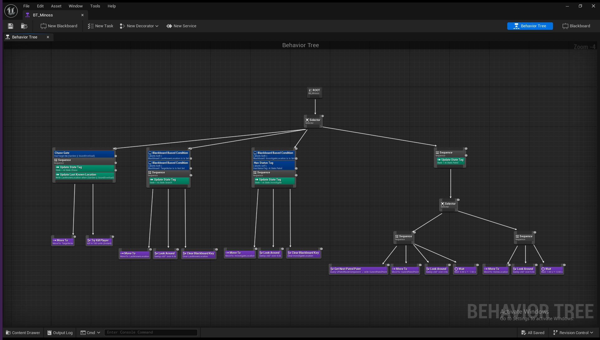

# BTTree: Enemy AI and Puzzle-Zone System Guide

Project ProjectMinoss_UE · Unreal Engine 5.6 · Written for new contributors.

---

## 1. What the system does

The project has one enemy that moves through a level, guards a set of puzzle zones, and reacts to what it sees and hears. While the enemy patrols, it walks between patrol points that belong to zones the player has not finished yet. If it sees the player, it chases. If it loses sight, it searches the last place it saw the player. If it hears enough noise in a short window, it is pulled toward the noise for a few seconds, even without seeing anyone. Once enough zones are completed, the enemy enters a permanent Rage state that makes it faster and gives it better sight. The enemy can also be stunned or blinded by status effects. If it gets within kill range of the player, it kills them. When the player dies, the whole world resets: the enemy goes home, zones are cleared, and the behavior tree restarts.

The code is split between a small amount of Unreal Engine plumbing (components, delegates, a game mode, a world subsystem) and the behavior tree itself, which is built partly from custom nodes and partly from data assets that are authored in the editor.

---

## 2. Architecture at a glance

Think of the system as layers. Each layer mostly talks to the layers directly below it.

```
  GAME FLOW        AEnemyGameMode ──resets──► AEnemyAIController, UPuzzleZoneSubsystem, player pawn
                   ▲ death event
                   │
  PLAYER CONTRACT  UHealthComponent (on player), IKillable (implemented by player)
                   ▲ Kill() called by enemy
                   │
  BRAIN            AEnemyAIController  (perception, status and noise listeners, Blackboard writes)
                   │ runs
                   ▼
  BEHAVIOR TREE    Decorators (gate branches) · Services (per-tick writes) · Tasks (actions)
                   │ read / write
                   ▼
  BLACKBOARD       Keys named in AIBlackboardKeys.h; StateTag uses the custom GameplayTag key type

  BODY & MEMORY    AEnemyCharacter ── StatusEffectComponent, PatrolRouteComponent
                   AEnemyAIController ── NoiseQueueComponent
  WORLD STATE      UPuzzleZoneSubsystem (completed zones) · APatrolPoint actors (placed in the level)
  DATA             UEnemyGameSettings (tuning and zone list) · EnemyGameplayTags (native tags)
```

The enemy is an AEnemyCharacter pawn controlled by an AEnemyAIController. The controller is the hub: it owns the perception component and the noise queue, it writes the Blackboard, and it reacts to status changes. The behavior tree makes the decisions, but its nodes are thin. Most real logic lives in the controller and the components it coordinates.

---

## 3. Core concepts

Before reading individual files, it helps to understand the five ideas the rest of the code is built on.

**Gameplay tags as state.** The enemy's behavior mode is a single gameplay tag: `AI.State.Patrol`, `AI.State.Chase`, `AI.State.Search`, or `AI.State.Investigate`. The tag is stored in the Blackboard under the key `StateTag`. Status effects such as `State.Debuff.Stunned` or `State.Buff.Rage` are also gameplay tags, but they live in a separate component and are not part of the state key. The tags are declared as native C++ tags in EnemyGameplayTags.cpp, so no tag ini entries are needed for them.

**Blackboard keys as shared memory.** The behavior tree and the C++ code communicate through named Blackboard keys: `TargetActor` (who the enemy is currently tracking), `LastKnownLocation` (where the target was last seen or heard), `InvestigateLocation` (the latest noise), `CurrentPatrolPoint`, `HomeLocation`, and `StateTag`. The names are constants in AIBlackboardKeys.h. The source warns that these strings must match the Blackboard asset exactly, and they are case-sensitive.

**Status effects with stack policies.** A status is a tag with an optional duration. When a status is applied, the caller chooses one of three policies. Extend adds the new duration to the remaining time. Refresh resets the timer to the full duration. Ignore does nothing if the status is already active. Every application gets a generation number, so an expiry timer from an older application cannot remove a newer one. A duration of zero means the status lasts until it is removed, which is how Rage works.

**Noise as a sliding window.** Each heard noise is pushed into a queue. Records older than the window (4 seconds by default) are purged. When the number of records in the window reaches the threshold (3 by default), the queue fires an overload event. Overload applies the SoundOverload status for 6 seconds, which lets the enemy chase whatever made the noise, even without sight.

**Zones and patrol routes.** A puzzle zone is identified by a gameplay tag. The subsystem records which zones are completed. Patrol points are placed in the level, and each one carries a zone tag. A patrol route is an ordered list of major points, and each major point can have minor points. The enemy skips any point whose zone is already completed. When every point is skipped, patrol is exhausted and the enemy idles at home.

---

## 4. File-by-file reference

This section describes every source file in the project. Each .h and .cpp pair is covered once, grouped by responsibility.

### 4.1 Settings, tags and keys

**EnemyGameSettings.h / .cpp.** A UDeveloperSettings subclass. Its values appear in the Project Settings editor and are saved to the project's ini files under the Game section. It holds every tunable number for the system: the zone ID list (`ZoneIds`, which is the source of truth for how many zones exist), the Rage threshold ratio (default 0.6667), the Rage speed and sight multipliers (1.4 and 1.3), the noise threshold (3), the noise window (4 seconds), the overload duration (6 seconds), walk and chase speeds (200 and 500), sight radius (1500), field of view (70 degrees), and hearing range (2500). Other code reads these through the static accessor `UEnemyGameSettings::Get()`. Edit values here, not in constructors. The controller constructor sets default sight and hearing values, but `OnPossess` overwrites them from these settings.

**EnemyGameplayTags.h / .cpp.** Declares the native gameplay tags in the `EnemyTags` namespace. There are four state tags (Patrol, Chase, Search, Investigate), two debuff tags (Stunned, Blinded), and two buff tags (Rage, SoundOverload). The state tags are mirrored into the Blackboard. The debuff and buff tags are used by the status effect component and the controller.

**AIBlackboardKeys.h.** A header-only namespace of inline `FName` constants, one per Blackboard key. Using constants prevents typos in string literals across the codebase.

**BlackboardKeyType_GameplayTag.h / .cpp.** A custom Blackboard key type that stores an `FGameplayTag` directly in Blackboard memory. Without it, the Blackboard could not hold tags. The class implements memory initialization and cleanup, equality comparison, and the template helpers `GetValue` and `SetValue` that the Blackboard component uses. Any Blackboard key of this type must be created as a Gameplay Tag key in the Blackboard editor, so this file has to compile before the Blackboard asset can be authored.

### 4.2 World state

**PuzzleZoneSubsystem.h / .cpp.** A UWorldSubsystem, so there is one instance per game world. It is created only in game worlds, not in the editor. At initialization it reads the zone count from the settings. It keeps a set of completed zone tags. `MarkZoneCompleted` adds a tag to the set and broadcasts `OnZoneCompleted`. The method is idempotent, so marking the same zone twice does nothing. `IsZoneCompleted`, `GetCompletedCount`, and `GetTotalZoneCount` are read-only queries used by the patrol logic and the Rage calculation. `Reset` clears the set and broadcasts `OnZonesReset`. Only the game mode calls `Reset`. `OnZoneCompleted` is a dynamic delegate, so Blueprints can bind to it. `OnZonesReset` is a C++-only delegate with no listeners in this code.

### 4.3 The enemy body

**EnemyCharacter.h / .cpp.** The enemy pawn, derived from ACharacter. Its constructor creates a StatusEffectComponent and a PatrolRouteComponent. At BeginPlay it caches its spawn location as `HomeLocation`, which is where it returns on reset and where it idles when patrol is exhausted. It also subscribes to its status component's add and remove events. The character owns movement speed. `RecalculateMovementStats` computes `MaxWalkSpeed` from scratch each time: it starts from the walk or chase speed depending on the Blackboard's StateTag, then multiplies by the Rage multiplier if Rage is active. It never multiplies the existing value, so repeated calls cannot compound. It is called at possession, on status add and remove, and by the BT service that updates the state tag.

### 4.4 The brain

**EnemyAIController.h / .cpp.** The most important file in the system. It connects everything else.

At construction, it creates the AIPerceptionComponent, the NoiseQueueComponent, and two sense configurations. Sight is the dominant sense, detects enemies and neutrals, and ignores friendlies. Hearing has its own range. Both values are overwritten later from settings.

In `OnPossess`, it runs a fixed initialization sequence. It starts the Blackboard and the behavior tree, then writes the default Blackboard values: home location, state Patrol, and the other keys cleared. The order matters, because the defaults are written after the tree starts. It then subscribes to the status component, the noise component, the zone subsystem, and the perception component, and finally tells the character it has been possessed.

For perception, `HandleTargetPerceptionUpdated` handles two cases. A successful sight stimulus sets `TargetActor` and marks the controller as able to see the target. A lost sight stimulus writes the target's current location into `LastKnownLocation` and then clears `TargetActor`, so the Search state has a destination. A successful hearing stimulus is pushed into the noise queue.

For statuses, `HandleStatusAdded` and `HandleStatusRemoved` implement what each status means. Stunned stops the behavior tree and movement. When the stun ends, the tree restarts, unless the removal reason is Reset, because the game mode owns the restart during a reset. Blinded saves the last known location, clears the target, and disables sight, except when SoundOverload is active, which lets the enemy keep tracking. Removing Blinded re-enables sight. Rage recalculates the sight radius. SoundOverload points `TargetActor` at the noise instigator when applied, and clears the target on removal if the enemy cannot currently see it.

For noise, `HandleNoiseOverload` applies SoundOverload using the settings duration. `HandleInvestigateLocationChanged` mirrors the noise queue's latest location into the `InvestigateLocation` key.

For zones, `HandleZoneCompleted` calls `ApplyRageIfThresholdMet`. That function computes the required count as the ceiling of total zones times the ratio, and applies Rage with infinite duration and the Ignore policy once the completed count reaches it.

For reset, `PrepareForReset` runs the first half of the reset sequence, and `ResumeAfterReset` runs the last step. Both are covered in section 5.7.

The controller also exposes `CanSeeTarget()`, a cached boolean that decorators and services read every tick. This avoids repeated perception queries from inside the behavior tree.

### 4.5 Noise

**NoiseQueue.h / .cpp.** A plain C++ struct with no UObjects, timers, or world access, so it can be unit tested. It holds noise records, each with a location, an instigator, and a timestamp. `Push` adds a record and purges expired ones. `ShouldTrigger` is true when the record count reaches the threshold. The file also contains an automation test named `Enemy.NoiseQueue`, which checks the threshold and expiry behavior. It runs from the Session Frontend or the editor test window.

**NoiseQueueComponent.h / .cpp.** The Unreal wrapper around the pure queue. It lives on the controller, is created in the controller's constructor, and ticks every 0.25 seconds to purge expired noise. When a noise is pushed, it broadcasts the new investigate location. If the threshold is reached, it clears the queue, marks itself overloaded, and broadcasts `OnNoiseOverload`. When the last record expires, it broadcasts an invalid investigate location so stale noise cannot pull the enemy. `Clear` is used by the reset sequence.

### 4.6 Status effects

**StatusEffectComponent.h / .cpp.** A generic status container that lives on the enemy character. It stores active statuses in a map from tag to instance. Each instance holds its duration, its generation number, and its timer handle. `ApplyStatus` implements the stack policies from section 3. A timer is set for finite durations and calls `HandleExpiry` when it fires. `HandleExpiry` checks the generation before removing anything. `RemoveStatus` removes one tag and broadcasts the removal with a reason: Expired, Cleared, Reset, or Superseded. `ClearAll` removes every status with a given reason. The component broadcasts `OnStatusAdded` and `OnStatusRemoved`, which the character and the controller both subscribe to. The component does not know what any status does. The meaning of each status lives in its listeners.

### 4.7 Patrol

**PatrolPoint.h / .cpp.** An actor placed in the level. Each point has a zone tag and a type, Major or Minor. Major points carry an editable array of minor points, which are visited in order before the route moves on to the next major. The actor has a scene root and does not tick.

**PatrolRouteComponent.h / .cpp.** A component on the enemy that holds the ordered list of major points and tracks the current position. `GetNextPoint` takes the zone subsystem and returns the next point whose zone is not completed. It first tries the remaining minors of the current major. If none remain, it advances to the next major that is not completed, wrapping around the list, and takes that major's first valid minor if it has one. It returns null when no valid point remains. `ResetIndex` clears the position and is called during reset. The component does not tick.

### 4.8 Behavior tree nodes

The behavior tree asset is authored in the editor, not in code. The nodes below are the custom building blocks it is made from.

**BTDecorator_ChaseGate.h / .cpp.** Allows a branch to run only while the enemy is in pursuit. The condition is: a TargetActor exists, and either the controller can see the target or SoundOverload is active. It is a per-tick query against cached state and does not observe Blackboard changes.

**BTDecorator_HasStatusTag.h / .cpp.** A generic decorator that passes if the enemy has a given status tag. A checkbox inverts the result. Use it to gate a branch on Stunned, Blinded, or any other status.

**BTDecorator_ZoneNotCompleted.h / .cpp.** Passes while a zone is not yet completed. It uses its own override tag if one is set. Otherwise it reads the zone from the actor in `CurrentPatrolPoint`. If the zone cannot be determined, it passes, so an unknown zone can never trap the enemy.

**BTService_UpdateStateTag.h / .cpp.** A service, a node that runs alongside its branch, that writes a configured tag into `StateTag` when its branch becomes relevant, then recalculates movement speed. It has no interval, so it runs only on activation, not every tick. This is how the enemy switches between Patrol, Chase, Search, and Investigate.

**BTS_UpdateLastKnownLocation.h / .cpp.** A service that runs every tick while its branch is active. If a TargetActor exists and the controller can see the target, or SoundOverload is active, it writes the target's current position into `LastKnownLocation`. The Search state relies on this key to know where to go.

**BTTask_ClearBlackboardKey.h / .cpp.** A generic task that clears whichever Blackboard key is selected in the editor. It succeeds when a key is set.

**BTTask_GetNextPatrolPoint.h / .cpp.** Asks the enemy's patrol component for the next valid point and writes it into `CurrentPatrolPoint`. It fails when no valid point remains. The patrol branch treats that failure as a signal to fall through to the home-idle sequence.

**BTTask_LookAround.h / .cpp.** A latent task that sweeps the enemy's yaw back and forth in a sine wave around its starting rotation. The amplitude and duration are editable. The start rotation and elapsed time are stored in per-node memory, so several instances can run safely. It is used when the enemy reaches a point and needs to scan its surroundings.

**BTTask_TryKillPlayer.h / .cpp.** A latent task that kills the target if it is within kill range when the task starts. Range is checked first. With no kill montage set, the kill lands immediately. With a montage, the montage plays and the kill is applied when it ends. An option re-checks range after the montage, so a player who steps away during the wind-up is not killed. The task keeps its own per-node instance, because it stores the owner component and the montage delegate. Abort unbinds the delegate. The kill itself is delivered through the `IKillable` interface.

### 4.9 Game flow and the player contract

**EnemyGameMode.h / .cpp.** The game mode for this level. At StartPlay it caches the player's spawn location and rotation and subscribes to the player's health component death event. When the player dies, `HandlePlayerDied` calls `ResetGame`, the single place where a full reset happens. It runs ten steps in a fixed order, documented in the file. The enemy controller is stopped and cleared first. The player is teleported home and the Blueprint hook `ResetPlayerAndWorld` runs, where a project can reset inventory and world items. The zone subsystem is cleared. The behavior tree restarts last, so patrol sees fresh zone state. Finally `OnGameReset` is broadcast so UI, audio, and effects can respond.

**HealthComponent.h / .cpp.** A simple component for the player that tracks whether it is dead. `Die` marks the component dead and broadcasts `OnDied` with the killer. Repeated calls are ignored. It is the bridge between the player's gameplay and the game mode's reset. The component defines a `MaxHealth` value, but nothing in the code uses it, so it is not a damage system yet. See section 7.

**Killable.h / .cpp.** Defines the `IKillable` interface with one function, `Kill(AActor* Instigator)`, declared as a Blueprint-implementable native event. The enemy calls it on any actor it can kill. The player's class must implement it, typically by calling `Die` on its HealthComponent. The .cpp file is an unchanged template stub.

### 4.10 Module and build files

**ProjectMinoss_UE.Build.cs.** The module rules. It lists public dependencies on Core, CoreUObject, Engine, InputCore, and GameplayTags. Section 6.2 describes a required addition.

**ProjectMinoss_UE.h / .cpp.** The standard primary game module boilerplate. It contains no game logic.

---

## 5. How the pieces interact

This section walks through the main runtime flows. Reading it alongside section 4 should make the call paths clear.

### 5.1 Startup and possession

When the level loads, the world creates the PuzzleZoneSubsystem, which reads the zone count from settings. The game mode caches the player's spawn pose and subscribes to the player's HealthComponent. The enemy character is spawned. Its constructor creates the status and patrol components, and BeginPlay records its home location and subscribes to status events. The enemy controller then possesses the character and runs `OnPossess`. That function applies the perception settings, starts the Blackboard and behavior tree, writes the default Blackboard values, subscribes the controller to the status, noise, zone, and perception events, and calls `OnAIPossessed` on the character to set its initial movement speed.

### 5.2 Seeing the player

The AIPerceptionComponent fires a sight stimulus when the player enters the view cone. `HandleTargetPerceptionUpdated` sets `TargetActor` and marks `CanSeeTarget` as true. The Chase branch's ChaseGate decorator now passes. Its state service writes `AI.State.Chase` into `StateTag`, which recalculates movement speed to the chase value. The location service writes `LastKnownLocation` every tick while sight holds. When sight is lost, the controller writes the last known location, clears `TargetActor`, and sets `CanSeeTarget` to false. ChaseGate fails and the tree falls through to Search.

### 5.3 Hearing noise and overload

A heard noise pushes a record into the NoiseQueueComponent, and the latest location is written to `InvestigateLocation`. If the number of noises in the window reaches the threshold, the queue clears itself, marks itself overloaded, and fires the overload event. The controller applies SoundOverload for the configured duration, using the Refresh policy so repeated overloads extend it, and points `TargetActor` at the noise instigator. ChaseGate passes on overload even without sight. When SoundOverload expires, the controller clears `TargetActor` if the enemy cannot currently see anything.

### 5.4 Stun and blindness

Stunned stops the behavior tree in Safe mode and stops movement, so the enemy freezes where it is. Removing Stunned restarts the tree, unless the removal reason is Reset. Blinded saves the last known location and clears the target, unless overload is active, in which case the target is kept so the enemy can keep chasing by sound. Blinded also disables the sight sense. Removing it re-enables sight.

### 5.5 Zone completion and Rage

`MarkZoneCompleted` records the zone and broadcasts `OnZoneCompleted`. The controller computes the Rage threshold as the ceiling of total zones times the ratio. When the completed count meets it, Rage is applied with no duration and the Ignore policy, so it is applied at most once. Rage multiplies movement speed and sight radius, and it persists until a reset.

### 5.6 Kill sequence

The Try Kill Player task checks kill range. With no montage it kills immediately through `IKillable`. With a montage, it waits for the montage to end, optionally re-checks range, and then calls `Kill` on the target. The player's `Kill` typically calls `Die` on its HealthComponent, which broadcasts `OnDied` to the game mode.

### 5.7 Full reset

The game mode's `ResetGame` runs in this order. First, the controller's `PrepareForReset` stops the tree in Safe mode, stops movement, clears statuses with the Reset reason, clears the noise queue, forgets perception, clears Blackboard keys except home location, sets the state to Patrol, teleports the enemy home, and resets the patrol index. Second, the player is teleported to the spawn pose and `ResetPlayerAndWorld` runs. Third, the zone subsystem's `Reset` clears completed zones. Fourth, the controller's `ResumeAfterReset` restarts the tree. Last, `OnGameReset` is broadcast. The tree restarts after zones are cleared so patrol sees a fresh state, and the broadcast comes last so UI and effects see a finished reset.

---

## 6. Building this on a new project

This section walks through reproducing the system in a fresh Unreal project. The steps are in the order they are needed. The code steps come first, followed by the editor steps that wire the code into a working enemy.

### 6.1 Prerequisites

Use Unreal Engine 5.6. The code uses `UE_DECLARE_GAMEPLAY_TAG_EXTERN` and the 5.6 Blackboard key type API, so earlier versions will not compile without changes. Enable the Gameplay Tags and AI plugins, which are on by default in most templates. A blank C++ project works as the starting point.

### 6.2 Module dependencies

Add the AI module to the module's dependencies. The AI headers used across the code, including AIController, BehaviorTree, Blackboard, and Perception, live in AIModule. The current Build.cs does not list it. Add it to `PublicDependencyModuleNames` alongside GameplayTags, or the build will fail to find those headers. Depending on engine configuration, GameplayTasks may also need to be listed, because the behavior tree depends on it.

### 6.3 Copy the source and compile

Copy all .h and .cpp files into the module's Source folder under the project name. Keep the file names exactly as they are, because Unreal Header Tool generates headers from them. Regenerate project files and build. The gameplay tags, the custom Blackboard key type, and the settings class must compile before the editor steps below will work. The `Gameplay Tag` key type only appears in the Blackboard editor once the module has loaded, so compile and restart the editor if it is missing.

### 6.4 Project settings

Open Project Settings and find the Enemy Game Settings section under Game. Add one gameplay tag to Zone IDs for each puzzle zone, using tags in the `Zone` category, such as `Zone.Hall` or `Zone.Vault`. The count of these tags drives the Rage threshold. Set the Rage ratio, noise threshold, noise window, overload duration, speeds, and sight values here. They are saved to DefaultGame.ini under the Game section, so they can be version controlled.

### 6.5 Create the Blackboard asset

The Blackboard is a data asset that defines the schema the behavior tree and the AI controller share. It holds the keys and their types, and nothing else.

1. In the Content Drawer, create an `AI` folder under `Content/` if one does not exist.
2. Right-click inside the folder and choose **Artificial Intelligence → Blackboard**.
3. Name the asset `BB_Enemy`.
4. Double-click `BB_Enemy` to open the Blackboard Editor. The Blackboard panel on the left is where keys are added. The Blackboard Details panel on the right is where a selected key's type and properties are set.

### 6.6 Add the six keys

The C++ code refers to these keys by the `FName` constants in AIBlackboardKeys.h. The names must match exactly, character for character, because the code finds keys by name. Click **New Key** six times and configure each key as shown below.

| Key Name (exact) | Key Type | Base Class / Extra | Purpose |
|---|---|---|---|
| `TargetActor` | Object | Base Class = Actor | The player pawn the enemy is chasing. |
| `LastKnownLocation` | Vector | none | Where the player was last seen, or tracked during overload. |
| `InvestigateLocation` | Vector | none | The most recent noise location. |
| `CurrentPatrolPoint` | Object | Base Class = PatrolPoint | The patrol waypoint the enemy is moving toward. |
| `HomeLocation` | Vector | none | Fallback destination when no patrol points remain. |
| `StateTag` | Gameplay Tag | the custom key type from this project | Mirrors the current AI state. |

Two of these types need extra care. For `TargetActor`, the base class must be `Actor`, not `Pawn`. The perception system delivers `AActor*` stimuli, and a `Pawn` base class causes silent type mismatches when the Blackboard tries to store the value. For `CurrentPatrolPoint`, the base class is the `APatrolPoint` C++ class. If it does not appear in the dropdown, confirm that the module compiles.

`StateTag` must use the custom `Gameplay Tag` key type. Do not substitute a Name or Enum key. The custom type exists so that `MatchesTagExact` works in the Chase and Investigate decorators, and a Name key would require string comparison and lose hierarchical tag matching.

### 6.7 Create the Behavior Tree asset

The behavior tree references the Blackboard, and without that link the tree cannot read or write any key.

1. In the same `AI` folder, right-click and choose **Artificial Intelligence → Behavior Tree**. Name it `BT_Enemy`.
2. Double-click `BT_Enemy` to open the Behavior Tree Editor.
3. In the toolbar, find the Blackboard Asset dropdown, which usually shows "None". Select `BB_Enemy`.
4. The Blackboard panel should now list all six keys. If it stays empty, the reference did not stick. Reopen the dropdown and select `BB_Enemy` again.

After assigning the Blackboard, the `StateTag` key should show `(None)`. If it shows a hex string instead, the `DescribeValue` override in the custom key type is not being used. Check that the override is declared in the header as `protected` and marked `override`.

The node layout is covered in 6.12, after the wiring is complete.

### 6.8 Assign the Blackboard and tree to the AI Controller

`AEnemyAIController` exposes two editable slots, `BehaviorTreeAsset` and `BlackboardAsset`. Fill them on the Blueprint subclass that runs in the game, not on the C++ class itself.

1. If no Blueprint exists yet, go to the Content Drawer, right-click, choose **Blueprint Class**, search for `EnemyAIController`, and name the result `BP_EnemyAIController`.
2. Open `BP_EnemyAIController` and go to **Class Defaults**.
3. In the AI category, set **Behavior Tree Asset** to `BT_Enemy` and **Blackboard Asset** to `BB_Enemy`.
4. Compile and save.

### 6.9 Assign the AI Controller to the enemy character

The enemy character must be possessed by this controller and not the default AI controller. Possession is what triggers `OnPossess`, which starts the tree and writes the Blackboard defaults.

1. Open the enemy character Blueprint, the one derived from `AEnemyCharacter`.
2. Go to **Class Defaults**.
3. Under the Pawn category, set **AI Controller Class** to `BP_EnemyAIController`.
4. In the same category, set **Auto Possess AI** to **Placed in World or Spawned**. This makes the controller possess the pawn whether the enemy is placed in the level or spawned at runtime.

### 6.10 Set up the patrol route

The patrol component on the enemy needs its waypoints before it can patrol.

Place patrol point actors in the level. Give each one a zone tag that matches an entry in Zone IDs, and mark it as Major or Minor. Minor points belong to the Major above them in the route.

Select the enemy in the level and open its patrol component. Fill the Majors array with the Major patrol points in the order the enemy should visit them. For each Major that has minor points, set its MinorPoints array in the order they should be visited. The Majors list is the only place the route order is stored, so keep it in sync with the level layout.

### 6.11 Set up the game mode and player

Set the level's game mode to `AEnemyGameMode`, or to a Blueprint subclass of it that overrides `ResetPlayerAndWorld`. The player pawn must have a `UHealthComponent`, and its class must implement `IKillable`. In its Kill implementation, call Die on the health component and pass the killer. The enemy will not reset the world unless this chain is in place. The game mode logs a warning at startup if the health component is missing.

### 6.12 Build the behavior tree structure

The diagram below is the reference layout for `BT_Enemy`. The prose after it explains what each branch does.

```
BT_Enemy   (Blackboard: BB_Enemy)

Root Selector   (runs top to bottom; the first branch that succeeds wins)
│
├── 1. CHASE
│      Decorators:  ChaseGate                              abort: Both
│      Services:    Update State Tag → Chase
│                   Update Last Known Location
│      Tasks:       Move To  (TargetActor, stop at kill range)
│                   Try Kill Player
│
├── 2. SEARCH
│      Decorators:  LastKnownLocation is set               abort: Both
│                   TargetActor is not set                 abort: Both
│      Services:    Update State Tag → Search
│      Tasks:       Move To  (LastKnownLocation)
│                   Look Around  (about 2 seconds)
│                   Search Nearby  (optional)
│                   Clear Blackboard Key  (LastKnownLocation)
│
├── 3. INVESTIGATE
│      Decorators:  InvestigateLocation is set             abort: Both
│                   StateTag equals Patrol  *              abort: Self
│      Services:    Update State Tag → Investigate
│      Tasks:       Move To  (InvestigateLocation)
│                   Look Around
│                   Clear Blackboard Key  (InvestigateLocation)
│
└── 4. PATROL   (fallback, no decorator)
       Services:    Update State Tag → Patrol
       Selector   (stops the branch from looping without progress)
       ├── Move to patrol point
       │      Get Next Patrol Point   (fails when no valid points remain)
       │      Move To  (CurrentPatrolPoint)
       │      Wait  (0.5 seconds, with random variation)
       └── Idle at home
              Move To  (HomeLocation, small acceptance radius)
              Wait  (10 seconds)

Key
  Decorator / Service    shown above the tasks in each branch
  abort: Both / Self     the decorator's Observer Abort setting
  *                      custom node, still to be built
```



Three parts of the diagram depend on nodes that the project may not yet contain, so check them before building the tree:

- **StateTagEquals** is marked as a custom node. The project has `BTDecorator_HasStatusTag`, but that checks status effects such as Stunned, not the `StateTag` key. You will need to write a decorator that compares the `StateTag` key against a tag, or use an equivalent check that reads the key through the Blackboard.
- **SearchNearby** is optional and is not in the project. Leave it out at first and add it later if the enemy should check the area around the last known location.
- **Wait** and **MoveTo** are built-in Behavior Tree nodes and need no custom code.

The branches below follow the diagram.

The first branch is Chase. It uses the ChaseGate decorator, Update State Tag set to Chase, the Update Last Known Location service, and a Try Kill Player task that runs when the enemy is close. It then moves to the last known location.

The second branch is Search. It runs when there is a last known location and no target. It sets the state to Search, moves to the location, and runs Look Around before clearing the key.

The third branch is Investigate. It is gated on the `InvestigateLocation` key and sets the state to Investigate.

The fourth branch is Patrol. It uses the Zone Not Completed decorator on each patrol step, then Get Next Patrol Point to pick the target, a move to it, and a Look Around on arrival. When Get Next Patrol Point fails, a home-idle sequence moves the enemy back to `HomeLocation` and waits there.

Every branch that changes state needs the Update State Tag service, because the state tag drives movement speed.

### 6.13 Complete zones during play

Anything in the level that solves a puzzle should call `MarkZoneCompleted` on the zone subsystem with the zone's tag. Blueprints can call the same function, since it is exposed as BlueprintCallable.

### 6.14 Verify the setup

Run the NoiseQueue automation test, `Enemy.NoiseQueue`, from the Session Frontend or the editor test window.

Then press Play and open the Gameplay Debugger by pressing the apostrophe key (`'`), switching to the Behavior Tree category. You should see the following:

- `HomeLocation` is set to the enemy's starting position. `OnPossess` writes it after the tree starts.
- `StateTag` shows `AI.State.Patrol`, not `(None)` and not a hex value.
- `TargetActor`, `LastKnownLocation`, `InvestigateLocation`, and `CurrentPatrolPoint` are empty. `OnPossess` clears them before the tree begins.

If `StateTag` shows `(None)`, the `SetValue` call in `OnPossess` likely failed. Check the Output Log for a `LogBlackboard` warning about a key type mismatch.

Then check the behavior in play. The enemy should patrol between points, chase when it sees the player, search the last known location when sight is lost, and be pulled toward three noises heard within four seconds. Completing enough zones should trigger Rage with a visibly faster walk. Dying in the level should reset everything.

### 6.15 Common pitfalls

A few mistakes are specific to this architecture and easy to make.

Do not add a seventh Blackboard key for puzzle completion. Puzzle state lives in `UPuzzleZoneSubsystem`. A `CompletedZones` key would create a second source of truth that can drift out of sync. The Zone Not Completed decorator queries the subsystem directly.

If `CurrentPatrolPoint` shows None at runtime, check that `APatrolPoint` compiles and that Get Next Patrol Point returns Succeeded. The task writes the key only on success. On failure, the Patrol branch falls through to the home-idle sequence, which is the intended behavior.

Blackboard memory is not cleared by restarting the tree. `PrepareForReset` clears the keys explicitly, because starting the tree alone would leave stale `LastKnownLocation` values from the previous run. This code should not be removed.

## 7. Known issues and gotchas

These items come from reading the source. Each is a point where the code behaves differently from what a reader would expect, or does not yet do what its comments describe. None of them stops the system from building, but a new developer should know about them before relying on the affected behavior.

**The player's death resets the world only once.** UHealthComponent sets `bDead` to true in `Die` and never sets it back. Nothing in the code clears it on reset. After the first death, every later call to `Die` returns early, so the game mode is never notified and the reset does not happen again. Fix this by adding a method that clears `bDead`, and calling it from the game mode's reset sequence or the player's respawn logic.

**The death binding is set only at startup.** AEnemyGameMode subscribes to the player pawn's HealthComponent in StartPlay. If the player pawn is replaced later, for example by a respawn that spawns a new pawn, the subscription is lost and death will not trigger a reset. Re-bind when the pawn changes.

**A dodged kill still reports success.** In BTTask_TryKillPlayer, when the range re-check after the montage fails, ApplyKill returns without killing. The montage-ended handler then finishes the task as Succeeded, so the behavior tree treats the attempt as completed. Finishing with Failed in that case would be more accurate. There is a related gap: if the montage is interrupted, the handler unbinds and returns without finishing the task, so the task only ends when the tree aborts it.

**The overload flag is never cleared.** UNoiseQueueComponent sets `bOverloaded` when the queue triggers. Its comment says the controller clears it when SoundOverload is removed, but the controller does not call `Clear` at that point. `Clear` would also wipe the noise queue and the investigate location, which is wrong on status expiry anyway. As a result, `IsOverloaded()` stays true after the first overload until a reset. Nothing in the code reads that method today, so the bug has no visible effect yet. Either clear the flag on expiry or remove the method.

**Rage needs more zones than a reader might expect.** The threshold is the ceiling of the total zone count times 0.6667. With three zones that is 3, so all zones must be completed. With six zones it is 5. If the design intends two-thirds, adjust the ratio or the rounding to match.

**Health has no damage model.** HealthComponent defines a `MaxHealth` property, but nothing reads it and no code applies damage. The only way to die is through Killable, so health is effectively a death flag. Plan for a damage system before relying on partial health.

**The reset runs inside a behavior tree task.** A kill can start inside a tree task. That task calls Kill, which calls Die, which notifies the game mode, which stops the same tree that is running the task. Stopping in Safe mode is meant to handle this, but the path is easy to break if the kill is moved or made asynchronous. Test resets thoroughly after changing the kill task.

**Stun restart assumes the tree asset exists.** The stun removal handler restarts the tree by dereferencing BehaviorTreeAsset with no null check. OnPossess guards against a missing asset, but this handler does not.

**Enemy reset uses a plain location set.** PrepareForReset moves the enemy home with SetActorLocation. For a character with a movement component, a teleport call is usually safer because it keeps movement state consistent. This has not been reported as a problem, but check it when the enemy's home is in a tight space.

**Some file names do not match their classes.** The file BTS_UpdateLastKnownLocation.h declares UBTService_UpdateLastKnownLocation. Unreal accepts this, but searching for a class name will not find the file. Consider renaming files to match their classes, or document the convention for the team.

**Several hooks have no listeners yet.** OnGameReset, OnZonesReset, and the controller's status and noise events are broadcast or handled, but OnGameReset and OnZonesReset are not bound anywhere in this code. They are intended for UI, audio, and effects, and Blueprints can bind to the dynamic ones.

**Constructor values are not the real values.** The controller's constructor sets sight and hearing defaults, but OnPossess overwrites them from settings. If a value appears to have no effect, check the settings, not the constructor.

**Comments refer to a design document that is not part of the project.** Comments cite sections such as "doc §10.1" and "doc §4.3". If that document exists, keep it with the code. It explains the reset order and the Blackboard rules in more detail than the source does.

---

## 8. What lives outside the source code

Three kinds of content are needed to run the system and are not stored in the source code. First, the behavior tree and Blackboard assets, described in section 6 as an inferred layout. Second, the Blueprint classes for the enemy, the player, and the game mode, with their component setup and any overrides of `ResetPlayerAndWorld`. Third, the DefaultGame.ini or other config that holds the enemy game settings and the zone list. Adding these three pieces to the team's repository closes most of the gaps a new developer would otherwise hit. The design document referenced in the comments would add the rationale behind the design choices.
